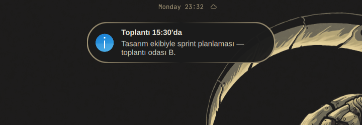
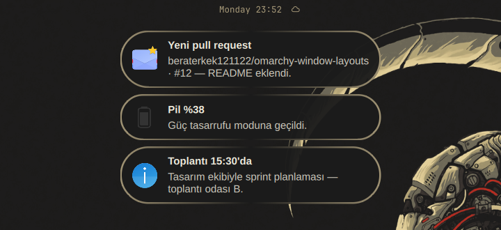

# Omarchy Notification Island

Omarchy'nin bildirim servisinin "ada" çatalı. Bildirimler sağ üst köşede
dikdörtgen kartlar olarak değil, **üstte ortada**, barın hemen altında yüzen bir
hap (pill) olarak belirir. Birden fazla bildirim alt alta yığılır; her yeni kart
barın altından açılırcasına girer ve üstteki kart gidince yığın yukarı kayar.





## Özellikler

- **Üst-orta ada** — barın altına ortalanmış, tamamen yuvarlatılmış hap
  görünümü; tema renkleriyle uyumlu.
- **Açılma animasyonu** — kartlar barın altından `scale + fade` ile açılır,
  kapanınca yığın yumuşakça yukarı kayar.
- Omarchy bildirim servisinin tüm yetenekleri korunur:
  - `org.freedesktop.Notifications` D-Bus servisi (düz `notify-send` çalışır)
  - Bildirim geçmişi ve geçmişi tekrar oynatma
  - Rahatsız Etmeyin (DND)
  - Aksiyonlar, varsayılan aksiyon, uygulamayı öne getirme
  - Resim / avatar desteği
  - Kalıcılık: shell yeniden başlasa da ekrandaki bildirimler geri gelir
  - Aciliyet (urgency) ve süre ayarları
- Aynı durum dizinini kullandığı için stok servisten geçişte **geçmiş ve DND
  ayarın korunur**.

## Gereksinimler

- [Omarchy](https://omarchy.org/) (Quickshell tabanlı Omarchy shell)

## Kurulum

> İki bildirim servisi aynı anda çalışamaz: ikisi de
> `org.freedesktop.Notifications` adını ister. Bu yüzden stok
> `omarchy.notifications` eklentisini kapatmak gerekir.

```bash
omarchy plugin add https://github.com/beraterkek121122/omarchy-notifications-island --enable
omarchy plugin disable omarchy.notifications
omarchy restart shell
```

Servis kendiliğinden yüklenmezse:

```bash
omarchy plugin enable berat.notifications
```

### Elle

```bash
git clone https://github.com/beraterkek121122/omarchy-notifications-island
mkdir -p ~/.config/omarchy/plugins/berat.notifications/components
cp omarchy-notifications-island/{manifest.json,Service.qml,NotificationLogic.js} \
   ~/.config/omarchy/plugins/berat.notifications/
cp omarchy-notifications-island/components/NotificationCard.qml \
   ~/.config/omarchy/plugins/berat.notifications/components/
omarchy plugin disable omarchy.notifications
omarchy plugin enable berat.notifications
omarchy restart shell
```

Doğrulamak için:

```bash
omarchy plugin validate ~/.config/omarchy/plugins/berat.notifications
notify-send "Merhaba" "Ada çalışıyor."
```

## Kullanım

- Bildirimler üstte ortada, barın altında görünür.
- Karta tıkla → varsayılan aksiyonu çalıştırır (varsa uygulamayı öne getirir);
  kartın kapat düğmesi bildirimi yığından kaldırır.
- Fareyle üzerine gelince aksiyon düğmeleri görünür.

### IPC komutları

```bash
omarchy-shell berat.notifications toggleDnd      # Rahatsız Etmeyin aç/kapat
omarchy-shell berat.notifications isDnd          # on / off
omarchy-shell berat.notifications showHistory    # geçmişi tekrar göster
omarchy-shell berat.notifications dismissAll     # ekrandaki tüm bildirimleri kapat
omarchy-shell berat.notifications dismissOne     # en yenisini kapat
omarchy-shell berat.notifications invokeLast     # en yenisinin aksiyonunu çalıştır
omarchy-shell berat.notifications clear          # geçmişi sil
omarchy-shell berat.notifications ping
```

### Dosyalar

| Yol | İçerik |
| --- | --- |
| `~/.local/state/omarchy/notifications.json` | DND ve görünüm ayarları |
| `~/.local/state/omarchy/notifications/` | Ekrandaki bildirimler (shell yeniden başlatmada geri yükleme) |
| `~/.local/state/omarchy/notifications/history/` | Geçmiş kayıtları |
| `~/.local/state/omarchy/notifications/images/` | Bildirim resimlerinin kopyaları |

## Nasıl çalışır?

Bu eklenti Omarchy'nin `omarchy.notifications` servisinin bir çatalıdır.
`Service.qml` dışındaki hiçbir dosya değiştirilmedi:

- `Service.qml` — bildirim sunucusu, geçmiş, DND, kalıcılık ve popup yerleşimi.
  Değişiklik yalnızca popup kabında: stok servisteki sağ üstteki `ColumnLayout`
  yerine üst-orta hizalı bir `Column`, yuvarlatılmış hap arka planı ve
  `transformOrigin: Item.Top` ile barın altından açılan giriş animasyonu.
- `NotificationLogic.js` — kart verisinin hazırlanması (stok ile aynı).
- `components/NotificationCard.qml` — kartın kendisi (stok ile aynı).

## Özelleştirme

`Service.qml` içinde:

| Ne | Nerede |
| --- | --- |
| Ada genişliği | `width: Style.space(360)` |
| Bar ile arasındaki boşluk | `anchors.topMargin: ... + Style.space(4)` |
| Giriş animasyonu süresi/eğrisi | kart delegesindeki `NumberAnimation` / `Behavior on y` |
| Hap yarıçapı | `cornerRadius` / kart arka planındaki `radius` |

## Notlar

- `Service.qml` değişikliklerinden sonra **`omarchy restart shell`** gerekir;
  sıcak yeniden yükleme bildirim D-Bus adını düşürebilir.
- Eklenti adı (`berat.notifications`) bilerek stok eklentiden farklı; böylece
  ikisi yan yana durabilir, yalnızca biri etkin olur.

## Lisans

[MIT](LICENSE) — Omarchy'nin
[`omarchy.notifications`](https://github.com/basecamp/omarchy) eklentisinden
türetilmiştir (MIT, Copyright (c) David Heinemeier Hansson).
